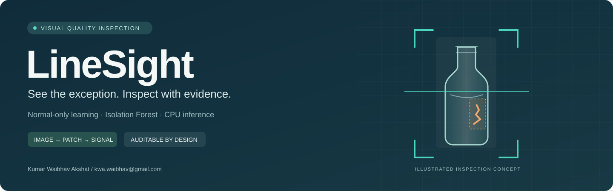
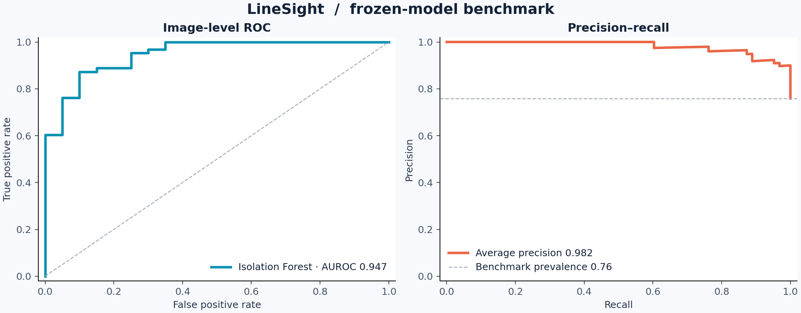

# LineSight

**An industrial visual inspection project that learns from good products and flags unusual ones with Isolation Forest.**

Built by **Kumar Waibhav Akshat** · [kwa.waibhav@gmail.com](mailto:kwa.waibhav@gmail.com)

[Try it locally](#run-the-inspection-console) · [Results](#measured-results) · [Architecture](docs/architecture.md) · [Dataset](docs/dataset-card.md) · [Model card](docs/model-card.md) · [Deployment](docs/deployment.md)

## The problem

A bottle inspection station must recognize damaged or contaminated products even when the next defect has never been labeled. Collecting examples of every failure is expensive; learning the appearance of normal products is a practical starting point.

LineSight implements that workflow on real industrial images from the **MVTec AD bottle** benchmark. A fixed-view visual feature pipeline describes departures from normal appearance. Isolation Forest turns those features into anomaly scores. A threshold estimated on separate normal images determines whether an image needs review.

The complete system includes data acquisition, traceable splits, model selection, calibration, held-out evaluation, visual explanations, an inference API, an interactive inspection console, and a container setup. It is a research and portfolio implementation for a controlled inspection view. Camera streaming is sampled image inference; factory operation has not been validated.

## What you can do

- **Inspect an image:** upload a product image and review its score, decision threshold, processing time, and coarse visual evidence.
- **Sample a camera:** send browser camera frames through the same detector with bounded in-flight requests.
- **Replay the benchmark:** walk through labeled dataset examples without presenting them as live camera input.
- **Review inspection events:** retain local inspection metadata for a compact operational history.
- **Reproduce the model:** rerun data preparation, four candidate experiments, independent threshold calibration, and the frozen test evaluation.
- **Audit the evidence:** inspect per-image predictions, defect-specific performance, uncertainty, stress tests, timing, and experiment logs.

## Measured results

The evaluation pipeline writes its evidence to [`reports/`](reports/). These values come from the frozen run; the score is an anomaly ranking value, not a defect probability.

<!-- RESULTS_START -->
**Frozen model `ls-a5006862e1ce` · official MVTec AD bottle test: 83 images (20 normal, 63 defective).**

| Metric | Observed | 95% stratified bootstrap interval |
| --- | ---: | ---: |
| Image AUROC | **0.9468** | 0.8857–0.9865 |
| Average precision | **0.9819** | 0.9611–0.9958 |
| Precision at frozen threshold | **96.36%** | 91.23–100.00% |
| Defect recall at frozen threshold | **84.13%** | 74.60–92.06% |
| F1 at frozen threshold | **89.83%** | 83.64–95.00% |

The selected `patch_if_max` model detected **53 of 63 defects**, missed **10**, and flagged **2 of 20 normal images**. It detected 20/20 large breaks, 19/22 small breaks, and 14/21 contamination cases. The threshold was **0.73856191**, calibrated exclusively on independent normal images. The observed test false-alarm rate is 10%; a 5% calibration target does not promise a 5% rate in each small test set.

Measured CPU model inference was **139 ms median / 325 ms p95** over 83 images after two warmups, with one forest thread on the shared Linux environment. This includes preprocessing, feature extraction, and forest scoring; it excludes image decoding, HTTP, queues, storage, and camera capture. It is not a hard real-time guarantee.

**Controlled imaging is essential:** reducing brightness to 80% or shifting the resized 192 × 192 view by 8 pixels caused **all 20 normal test images to be flagged**. Increasing brightness to 120% flagged 12/20 normals. These frozen-model stress results identify a clear deployment boundary; the model is not ready for arbitrary camera conditions.

A simple normal-reference residual baseline achieved AUROC **0.9389** and recall **76.19%**, versus **0.9468** and **84.13%** for Isolation Forest. The forest's higher recall came with two false alarms versus zero for that baseline. This is a modest observed tradeoff on one small benchmark, not a claim of statistically significant superiority.



[Full evaluation](reports/evaluation.md) · [Machine-readable metrics](reports/metrics.json) · [Every test prediction](reports/test_predictions.csv) · [Score distribution + confusion matrix](reports/figures/scores_confusion.png) · [Development + stress results](reports/figures/development_robustness.png) · [Defect coverage + latency](reports/figures/defects_latency.png) · [Image evidence + dataset annotations](reports/figures/inspection_examples.png)
<!-- RESULTS_END -->

## Run the inspection console

Use **Python 3.11–3.13**. From the repository root:

```bash
python -m venv .venv
# macOS/Linux
source .venv/bin/activate
# Windows PowerShell: .venv\Scripts\Activate.ps1
python -m pip install -r requirements.lock
python -m pip install -e '.[dev]'
python scripts/download_data.py
python scripts/train.py --root .
python scripts/evaluate.py --root .
python scripts/serve.py
```

Open **http://127.0.0.1:8000**. Permit camera access only when using camera inspection. Browsers generally require localhost or HTTPS for camera access.

A supplied trained artifact can be used immediately after dependency installation; the downloader is needed for benchmark replay and full reproduction. Dataset access requires agreeing to its **noncommercial** terms; read the [dataset card](docs/dataset-card.md) before downloading. The supplied [`requirements.lock`](requirements.lock) records the runtime versions used for this handoff.

Run the automated checks:

```bash
python -m pytest
```

The recorded verification completed **50 tests with zero failures or skips**, executed all **8 notebook code cells**, and found **zero known advisories among 30 pinned runtime packages** in the point-in-time dependency audit. See [`reports/verification.json`](reports/verification.json) and [`reports/dependency-audit.json`](reports/dependency-audit.json). This verification record separately identifies browser, camera-hardware, and Docker checks; it does not treat unperformed checks as passes.

The runtime uses **Pillow 13.0.0**. The original training record retains Pillow 12.3.0 for provenance; all **83 frozen test scores and decisions matched exactly** under the patched runtime without changing the model or threshold. See [`reports/runtime_verification.json`](reports/runtime_verification.json).

## Explore the notebook and report

- [Executed project walkthrough](notebooks/01_linesight_walkthrough.ipynb): data integrity, experiment history, calibration, measured results, plots, and an actual inference call.
- [Technical report PDF](output/pdf/LineSight_Technical_Report.pdf): the complete problem, method, evaluation, engineering evidence, and operating limits.

Rebuild these artifacts after training and evaluation:

```bash
python -m pip install -e '.[notebook,report]'
python scripts/build_notebook.py
python scripts/build_report.py
```

The notebook builder executes in an IPython process and saves real cell outputs; it does not retrain or select using test outcomes.

Create reviewable release archives with:

```bash
python scripts/package_release.py --output ../deliverables
```

This creates `LineSight_GitHub_Ready.zip` with source, model, reports, tests, and documentation, and `LineSight_Complete_Project.zip` with the verified raw dataset added. Both include a release manifest; `SHA256SUMS.txt` records archive hashes. The source archive excludes raw data and Git metadata. The complete archive retains the original dataset license and noncommercial restrictions. Packaging does not create a GitHub repository, push, or publish anything.

Container setup and environment variables are documented in the [deployment guide](docs/deployment.md). No external service, account, GPU, API key, or paid model is required for inference.

## How the model works

1. **Build a normal reference.** Resize to 192 × 192 RGB and learn pixel-wise appearance and gradient statistics from the normal fit split alone.
2. **Describe unusual appearance.** Summarize color, edges, and reference residuals into 144 spatial patches with 16 descriptors each. An alternative image representation aggregates residual statistics.
3. **Fit Isolation Forest.** Random feature splits isolate unusual descriptor vectors in fewer steps. LineSight uses `-score_samples` so that larger scores mean more unusual images.
4. **Choose the representation.** Compare an image detector and three patch pooling policies on tune normals plus deterministic synthetic corruptions. These proxy defects are not real test defects.
5. **Calibrate the decision.** Use independent normal calibration scores to choose a finite-sample upper order statistic at a target 5% nominal false-alarm level. The decision is `score > threshold`.
6. **Freeze, then test.** Record the selected configuration and threshold before opening the official test partition. Measure performance without selecting the threshold on test defects.


See the [architecture](docs/architecture.md) for the detailed data and serving paths, and the [model card](docs/model-card.md) for the exact score and calibration semantics.

## Dataset and leakage controls

**MVTec AD / bottle** provides real normal products and real defects. This project retains the original train/test boundary and subdivides only the normal training images.

| Role | Images | Used for |
| --- | ---: | --- |
| Fit | 125 normal | Reference statistics and forest fitting |
| Tune | 42 normal | Candidate selection with derived synthetic corruptions |
| Calibration | 42 normal | Independent decision threshold |
| Official test | 83 | Final frozen evaluation: 20 normal, 63 anomalous |

Seed **42** fixes the normal-image allocation. Paths, roles, labels, and image hashes are recorded in `data/manifest.csv`. Synthetic variants remain in the tune role with their source image. Pixel masks are retained for provenance; no pixel segmentation accuracy is claimed.

The source package does not redistribute the raw dataset. Data images and derived visualizations retain their separate dataset terms; the [dataset card](docs/dataset-card.md) explains provenance and licensing.

## Inspect the repository

| Location | Purpose |
| --- | --- |
| `src/linesight/features.py` | Normal reference, image normalization, spatial descriptors, tune corruptions |
| `src/linesight/model.py` | Isolation Forest detector, scoring, threshold, serialization |
| `src/linesight/training.py` | Candidate selection, calibration, frozen model metadata |
| `src/linesight/evaluation.py` | Held-out metrics, uncertainty, plots, stress and latency checks |
| `src/linesight/api.py` | Image inspection API, events, sample access, console serving |
| `web/` | Browser inspection console |
| `scripts/` | Data acquisition, training, evaluation, serving, report, notebook, and release commands |
| `notebooks/` | Executed, inspectable project walkthrough |
| `output/pdf/` | Generated technical report |
| `configs/model.json` | Reproducible experiment policy and candidate configurations |
| `data/` | Manifest and acquired dataset; raw images excluded from source control |
| `artifacts/` | Trusted trained detector and metadata |
| `reports/` | Evaluation evidence, predictions, figures, and logs |
| `tests/` | Meaningful model, data, and API boundary checks |
| `docs/` | Architecture, dataset/model cards, deployment guide, presentation outline |
| `.github/workflows/` | Automated repository checks |

## Engineering choices

**Isolation Forest is the detector.** The reference statistics are feature engineering; image decisions come from an actual scikit-learn forest. The project keeps computation small enough to run on a CPU and makes each experimental decision reviewable.

**Score and explanation are explicit.** An anomaly score is not calibrated defect confidence. Patch models expose a 12 × 12 grid of local isolation scores. For the image representation, the heatmap is reference-residual evidence rather than an attribution of the forest. Both are coarse inspection aids.

**Evaluation includes failure cases.** A threshold-free AUROC can look strong while an operational threshold misses defects. The report therefore includes fixed-threshold precision and recall, class-specific counts, uncertainty, and stress tests on the frozen model.

**The application uses real inference.** Upload, camera, and benchmark replay call the same model endpoint. The console does not replace inference with precomputed labels. The sample browser is explicitly a benchmark replay.

## Limits and next steps

The model is specialized for a controlled bottle view. Different products, illumination, camera pose, backgrounds, or production batches require representative normal data and fresh validation. The small benchmark does not establish a factory false-alarm rate, detection SLA, or commercial suitability. Synthetic tune defects only approximate future abnormal appearance.

Useful extensions are triggered industrial-camera capture, verified reject-actuator integration, batch-aware holdouts, lighting qualification, drift monitoring, and comparison with deep embedding detectors. These should be evaluated on representative, appropriately licensed production data.

## Documentation

- [System architecture](docs/architecture.md)
- [Dataset card and provenance](docs/dataset-card.md)
- [Model card and decision policy](docs/model-card.md)
- [Deployment and operations](docs/deployment.md)
- [Project presentation outline](docs/presentation.md)
- [Third-party notices](THIRD_PARTY_NOTICES.md)

## Attribution and license

Original software and branding: **Kumar Waibhav Akshat** · [kwa.waibhav@gmail.com](mailto:kwa.waibhav@gmail.com). Software is released under the [MIT License](LICENSE).

MVTec AD is by Paul Bergmann, Michael Fauser, David Sattlegger, and Carsten Steger. The dataset uses [CC BY-NC-SA 4.0](https://creativecommons.org/licenses/by-nc-sa/4.0/). It is **not licensed for commercial use**. The software license does not change dataset restrictions. See [THIRD_PARTY_NOTICES.md](THIRD_PARTY_NOTICES.md) for the treatment of data-derived artifacts.

References: [MVTec AD](https://www.mvtec.com/research-teaching/datasets/mvtec-ad) · [MVTec AD paper](https://openaccess.thecvf.com/content_CVPR_2019/papers/Bergmann_MVTec_AD_--_A_Comprehensive_Real-World_Dataset_for_Unsupervised_Anomaly_CVPR_2019_paper.pdf) · [scikit-learn IsolationForest](https://scikit-learn.org/stable/modules/generated/sklearn.ensemble.IsolationForest.html).

The desktop dashboard was also checked in a managed browser: real bottle inference, sequential replay start/stop, decision history, and the self-hosted API reference worked. Physical camera capture and a Docker build were not verified. Exact evidence is in [verification.json](reports/verification.json).

When starting from a downloaded ZIP, initialize a local repository before release packaging:

```bash
git init -b main
git config user.name "Kumar Waibhav Akshat"
git config user.email "kwa.waibhav@gmail.com"
git add .
git commit -m "Build LineSight visual anomaly inspection system"
```

These commands create only local history. No remote or push is configured.
