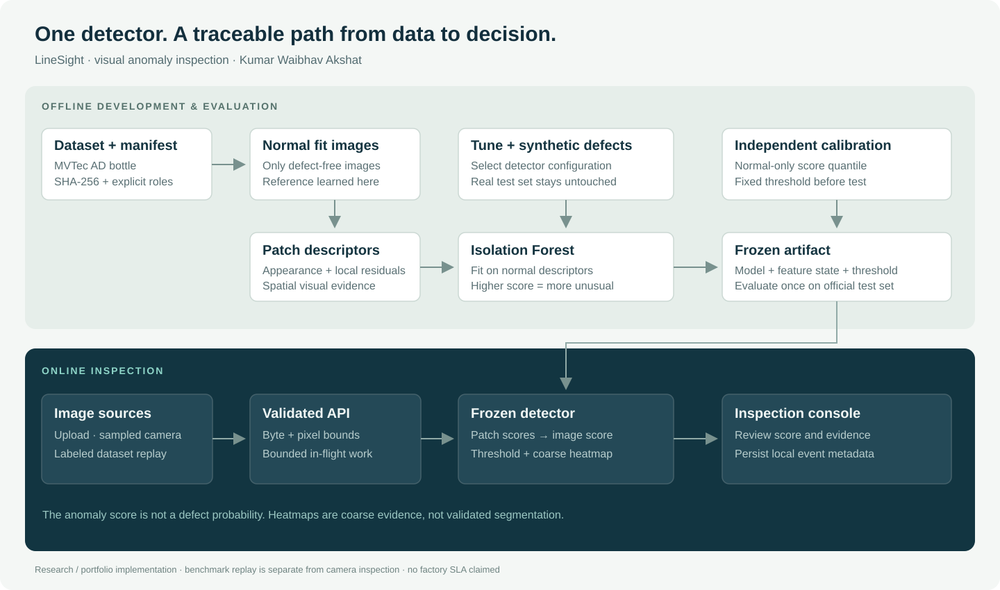
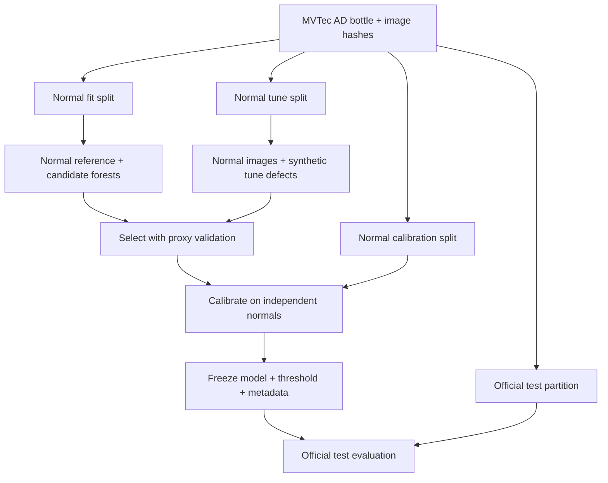
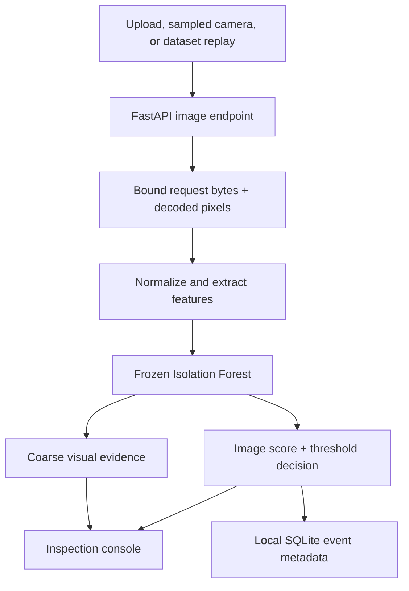

# LineSight architecture

**Owner:** Kumar Waibhav Akshat · kwa.waibhav@gmail.com

LineSight separates model development from image inspection. Both paths use the same Python feature extractor and saved detector. The browser sends images to the API; it never implements a second, approximate model.

## Development path

The original train/test boundary is retained. Fit data determines reference statistics and forest parameters. Tune data chooses among the planned configurations using reproducible proxy corruptions. Calibration data determines the image decision threshold after selection. Official test labels are used only to measure the frozen result.

The saved artifact contains the reference, forest, representation, pooling policy, threshold, model version, and metadata. Its hash binds evaluation results to a specific artifact. Reproduction depends on source revision, configuration, manifest, seed, and library versions; a seed alone does not guarantee identical artifacts across all environments.

## Inspection path

The API bounds incoming data before decoding and limits concurrent inference work. The browser waits for inspection completion before sending another camera frame, preventing an unbounded frame queue. Camera frames are samples of the stream, not evidence that every item on a production conveyor was inspected.

The inspection response separates the score, threshold, decision, model version, and timing. The evidence map is coarse and depends on the selected representation: patch isolation scores for a patch model; reference residuals for an image model.

## Component responsibilities

| Component | Responsibility | Boundary |
| --- | --- | --- |
| Dataset acquisition | Retrieve images, validate metadata, build manifest | Does not fit a model |
| Feature extractor | Build normal reference; convert an image to descriptors | Learns reference only from fit normals |
| Detector | Fit forest; score; apply a frozen threshold | Anomaly scores are not probabilities |
| Training | Select planned candidate; calibrate; record model | Does not evaluate official test defects |
| Evaluation | Score frozen model; write metrics and visual evidence | Does not optimize using test results |
| API | Validate requests; run inference; expose metadata and samples | Does not accept arbitrary filesystem paths |
| Browser console | Upload, camera sampling, replay, evidence, history | Makes the active source explicit |
| Event store | Retain local inspection metadata | Is an operational log, not a labeled training set |

## Deployment boundary

One application process serves the API and browser assets. The container setup is intended for local demonstration or an internal evaluation environment. Persistent runtime events should live in a mounted data directory. A production installation needs its own authentication, TLS/reverse proxy, monitoring, image acquisition timing, reject workflow, retention policy, and representative product validation.

There is no external deployment or GitHub publication in this prepared handoff.
