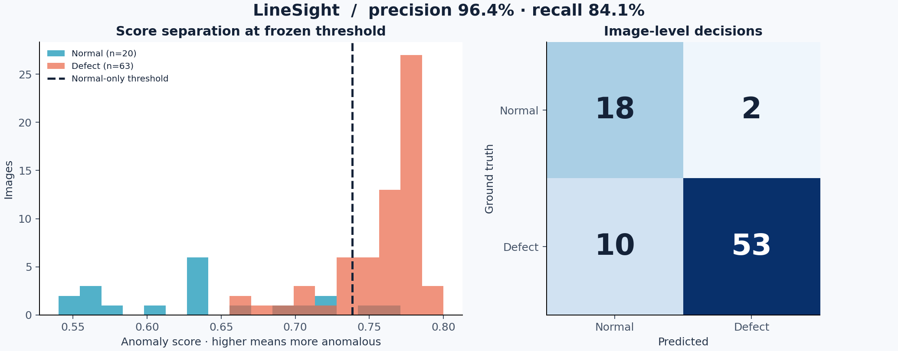
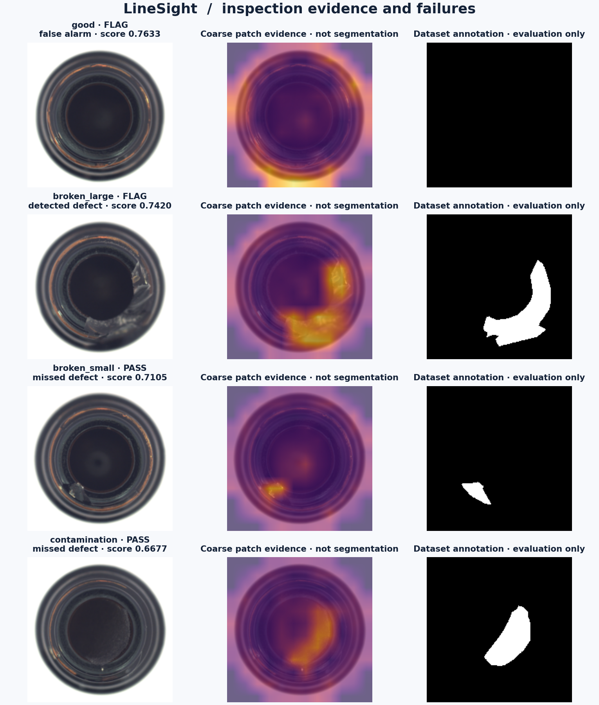
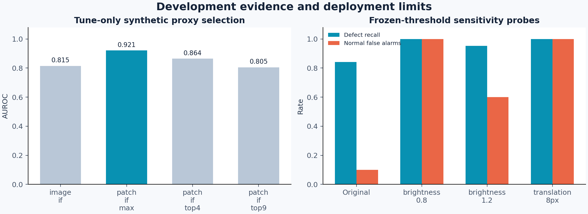
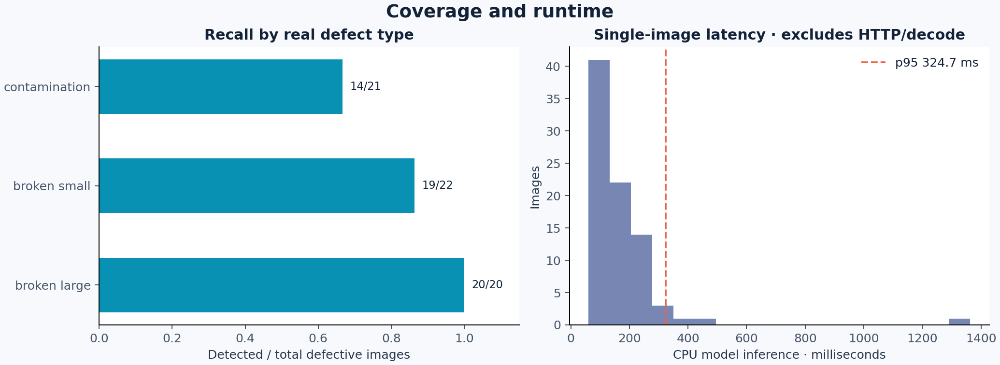

# LineSight — Frozen Model Evaluation

Owner: **Kumar Waibhav Akshat** · [kwa.waibhav@gmail.com](mailto:kwa.waibhav@gmail.com)

Model `ls-a5006862e1ce` · selected `patch_if_max`.
Official MVTec AD bottle test split: 83 images, 20 normal and 63 defective.
The selected Isolation Forest configuration and threshold were frozen before test-image evaluation.

| Metric | Observed | 95% stratified bootstrap interval |
|---|---:|---:|
| AUROC | 0.9468 | 0.8857–0.9865 |
| Average precision | 0.9819 | 0.9611–0.9958 |
| Precision | 0.9636 | 0.9123–1.0000 |
| Recall | 0.8413 | 0.7460–0.9206 |
| F1 | 0.8983 | 0.8364–0.9500 |

Confusion matrix: 18 true normal, 2 false alarm, 10 missed defect, 53 detected defect.
Anomaly scores are not probabilities. Precision reflects this defect-heavy benchmark, not a factory defect rate.

## Runtime

Single-image CPU model p50 **139.21 ms**, p95 **324.66 ms** across 83 images after two warmups; one forest thread.
This includes normalization, reference features and forest scoring. It excludes image decoding, uploads, HTTP, queueing, SQLite and capture.
No hard real-time or physical-camera deployment has been validated.

## Defect coverage

| Defect | Detected | Recall | Wilson 95% interval |
|---|---:|---:|---:|
| broken_large | 20/20 | 1.000 | 0.839–1.000 |
| broken_small | 19/22 | 0.864 | 0.667–0.953 |
| contamination | 14/21 | 0.667 | 0.454–0.828 |

## Frozen-model stress probes

These are post-freeze sensitivity checks, not additional model-selection runs.

| Condition | AUROC | Recall | Normal false-alarm rate |
|---|---:|---:|---:|
| brightness_0.8 | 0.838 | 1.000 | 1.000 |
| brightness_1.2 | 0.901 | 0.952 | 0.600 |
| translation_8px | 0.334 | 1.000 | 1.000 |

## Simple reference baseline

A fit-median standardized residual score (pixel 99.5th percentile), calibrated on the same independent normal split, achieved AUROC 0.9389, recall 0.7619, and F1 0.8649. This benchmark comparison is reported honestly and was not used to retune the selected Isolation Forest.

## Practical limits

- One fixed-view category; dataset replay is not a live factory validation.
- Official test has only 20 normal images; false-alarm uncertainty is large.
- Test defect prevalence differs from production and changes precision.
- Coarse patch evidence is not validated pixel segmentation.
- Brightness/pose drift can violate calibration assumptions and raise false alarms.
- Isolation Forest scores are ranking evidence, not defect probabilities.
- MVTec AD and benchmark-derived materials are noncommercial (CC BY-NC-SA 4.0).

## Reproduction and evidence

`python scripts/train.py --root .` freezes a fresh development run. `python scripts/evaluate.py --root .` checks the frozen artifact and manifest digests before evaluating.

Machine-readable results: `metrics.json`, `test_predictions.csv`, `calibration_scores.csv`, `experiment_history.csv`, `selection.json`, and `frozen_model.json`. Bootstrap uses 2,000 class-stratified resamples with seed 2026. Figures are generated from these measured results.

